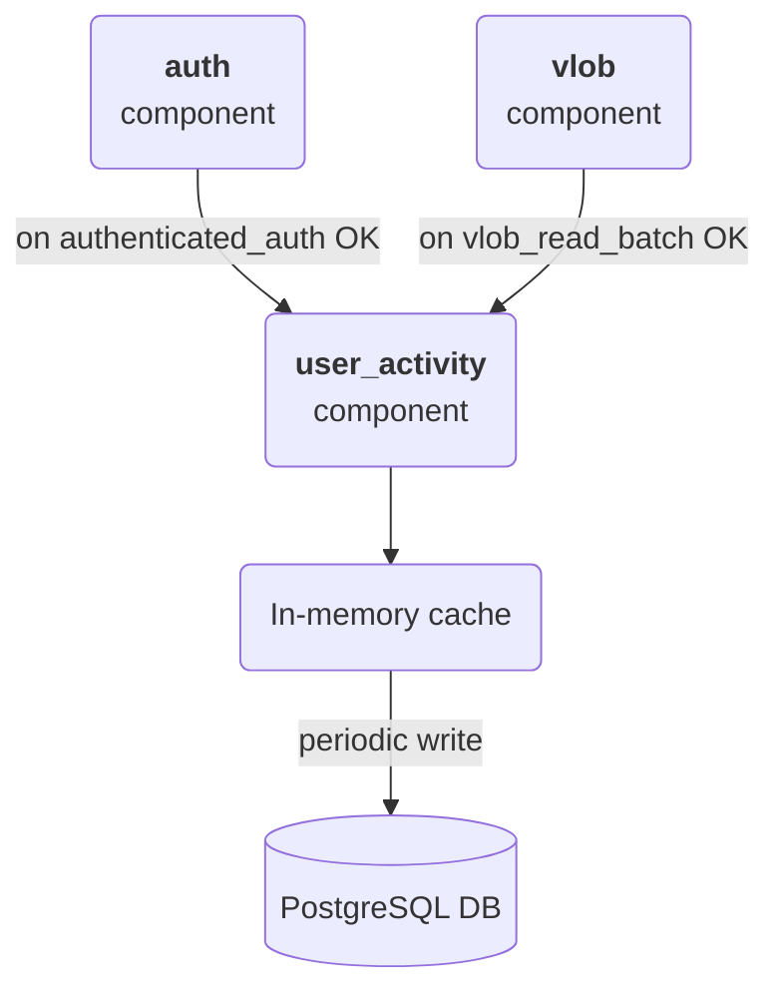
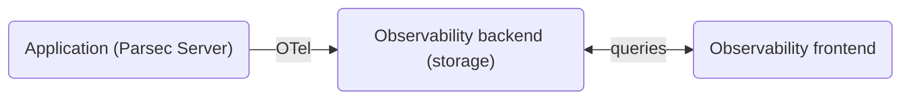

<!-- Parsec Cloud (https://parsec.cloud) Copyright (c) BUSL-1.1 2016-present Scille SAS -->

# RFC 1031: Server monitoring of user access

## Overview

This RFC describes how to securely track user access to Parsec Server, such as last user logins or
workspace accesses, in a way that does not leak confidential information (i.e. workspace name) but
still allows to monitor inactive users or devices.

## Background & Motivation

Organization administrators and workspace owners need a way to detect inactive users in order to
take appropriate measures (revoking users, removing workspace access) to limit the risk of
unauthorized access or device compromise for devices that the user may have left behind.

Two informations are particularily interesting to this aim:

- The last time a user access an organization (i.e. authenticated with the server)
- The last time a user read data from a specific workspace

Note that since the concept of session does not exist in Parsec, every time a user *authenticates*
with the server can be considered as an access to the given organization (regardless of the specific
RPC route requested).

In the end, the server should be able to track and expose this information through one or more
authenticated routes in order to include it in exports or be displayed in the GUI.

## Goals

- Design server-side tracking for users most recent access to an organization or a workspace
- Design API to retrieve the tracking information

## Design

This RFC proposes to develop an *ad-hoc component* that will be responsible for server-side tracking
users most recent access to an organization or a workspace. This allows integration with Parsec
authentication mechanism (i.e. client-side auth to retrieve private key from device file, then
server-side auth via signed requests) and has the advantage that the data is immediately available
on the server when needed.

On the other hand, this method requires special attention to how the database writes will be handled
because tracking every access to a resource may result in significant degraded performance.

See the other ruled-out alternatives in [Alternatives Considered](#alternatives-considered).

### The ad-hoc component approach

A new `user_activity` component is added to the server.

This component is called from wherever needed, for example:

- on auth success, to notify a device is connecting
- on vlob read success, to notify a device is accessing a workspace

To avoid overloading the database, the `user_activity` component stores the
tracking information in an in-memory cache and performs a periodic write to the
database.



### Tracking user access to an organization

Authentication is one of the first step during handling of the authenticated RPC routes (see
[`authenticated_api`](https://github.com/Scille/parsec-cloud/blob/d9e91f2351f1bdff9107adf2a8af0d51a3f62d47/server/parsec/asgi/rpc.py#L777)).

Essentially the *handshake* consists in the following steps:

1. HTTP header parsing (`_parse_auth_headers_or_abort`)
2. HTTP body parsing (`_rpc_get_body_with_limit_check`)
3. Parsec authentication using the authenticated token (`backend.auth.authenticated_auth`)

Any error on these steps, leads to handshake abort. If all steps succeed, authentication info is
obtained and the handshake is considered done. The actual RPC operation is then invoked.

> [!IMPORTANT]
> The `user_activity` component should be notified on every successful auth operation (just after
> handshake is done).

Information to include:

- Organization ID
- User ID
- Device ID
- Current Date (timestamp)

> [!NOTE]
> Should we also store the user agent?

### Tracking user access to a workspace

There are several ways to interact with a workspace (realm). Some operations involve the workspace
itself (create, rename, share, archive, etc) and other involve the workspace data (vlob operations).

In the context of this RFC, the goal is to detect users who have not recently accessed a workspace
in order for Owners and Managers of that workspace to review their access and eventually unshare it.
Therefore, it makes more sense to **track access to workspace data**. Besides, operations involving
the workspace itself can already be obtained through certificates.

> [!IMPORTANT]
> The `user_activity` component should be notified on every successful vlob operation.

Information to include:

- Organization ID
- User ID
- Device ID
- Realm ID
- Current Date (timestamp)

### Storage strategy in the `user_activity` component

To avoid overloading the database with every request, the `user_activity` component would collect
the tracking information and write it to the corresponding table(s) in the PostgreSQL database
every X seconds.

Note that since we are interested in a "last seen at" there is no need to aggregate or consolidate
data from the collected information.

Proposed tables structure to store tracking information:

```sql
CREATE TABLE user_last_seen (
    _id SERIAL PRIMARY KEY,
    organization INTEGER NOT NULL  -- REFERENCES organization (_id) ...
    user_ INTEGER NOT NULL,        -- REFERENCES user_ (_id) ...
    device_id INTEGER NOT NULL,    -- REFERENCES device (_id) ...
    last_seen_at TIMESTAMPTZ NOT NULL

CREATE TABLE user_realm_last_seen (
    _id SERIAL PRIMARY KEY,
    organization INTEGER NOT NULL  -- REFERENCES organization (_id) ...
    user_ INTEGER NOT NULL,        -- REFERENCES user_ (_id) ...
    device INTEGER NOT NULL,       -- REFERENCES device (_id) ...
    realm INTEGER NOT NULL,        -- REFERENCES realm (_id) ...
    last_seen_at TIMESTAMPTZ NOT NULL
```

### Protocol to retrieve user accesses

> [!NOTE]
> This should integrate well with how data would be retrieved for
> [#13598](https://github.com/Scille/parsec-cloud/issues/13158),
> [#13599](https://github.com/Scille/parsec-cloud/issues/13158) and
> [#13612](https://github.com/Scille/parsec-cloud/issues/13612).

## Alternatives Considered

### OpenTelemetry (OTel)

[OpenTelemetry](https://opentelemetry.io/docs/what-is-opentelemetry/) is an observability framework consisting in a set
of standards and tools for collecting telemetry and sending it to a monitoring service. It provides vendor-neutral
instrumentation and therefore requires an observability infrastructure (backend and frontend) to be deployed alongside
the application that is being monitored.



OTel is designed for short-term performance analysis, with observability tools typically deleting logs/spans after
14 or 30 days. This makes it not suitable for the proposed use case which requires to be able to reliably detect
long-term inactivity.

### Dedicated tools (Audit Logs / IAM)

There are dedicated tools to address security and compliance (such as SOC2/GDPR audit reports):

- Identity Providers (IdPs) like Auth0 or Keycloak, already natively log the `last_login` and provide webhooks or APIs
  to retrieve this information.

- Audit Log Frameworks, like OpenOS, WorkOS (Audit Logs), or Retraced allows to integrate immutable and exportable
  access logs for B2B customers.

These tools are unusable in our case because Parsec has its own decentralized cryptographic authentication logic and
server-side authentication based on signed requests.

## Operations

> Are you adding any new regular human processes or extra work for any teams?
> If this is a new system, who will run it?

## Security/Privacy/Compliance

> What security/privacy/compliance aspects should be considered?
> If you're not certain, never assume there aren’t any. Always talk to the security team.

## Risks

> What known risks exist? What factors may complicate your project?
> Include: security, complexity, compatibility, latency, service immaturity, lack of team expertise, etc.

## Remarks & open questions

### Should we track pre-auth activity?

Probably not. Device information is not available before auth so is not useful from a business-logic
perspective. Besides, tracking pre-auth probably fall in the OTel (observability) domain.

### Should we track failed auth activity (aka login *attemps*)?

Authentication may fail for several reasons:

- Organization not found or expired
- User or Device not found
- User revoked or frozen
- ToS not accepted
- Token is invalid or out of ballpark

Device information may be available or not depending on the specific bad outcome.

It might make sense to track this activity (`last_login_attempt_at`) whenever it can be uniquely
associated with the user.

However, when looking at login attempts, it is generally interesting to have access to all activity
(not just the most recent one) so it seems to fall out of scope for this RFC.

### Should we track activity on *anonymous* or *invite* routes?

Not useful from a business-logic perspective since this activity cannot be associated with a
specific user (except maybe invite). Besides, no sensitive information is available through this
routes.

Similar to tracking pre-auth activity, this seem more related to the OTel (observability) domain.

### Should we consider Redis?

Redis is a distributed, external in-memory data store. It may seems overkill for the purpose of this
RFC, but it has the advantage that can be shared across multiple servers.

Using in-memory cache is the fast approach: information is available when needed with no latency.
However, it is limited to a single server instance and data is lost on restarts.
